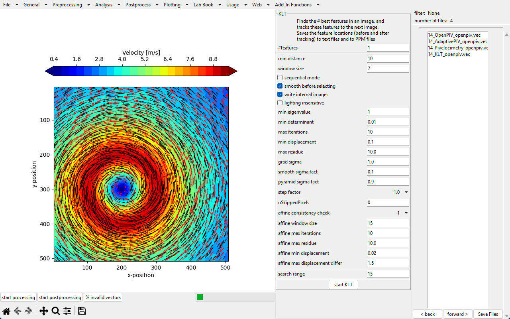
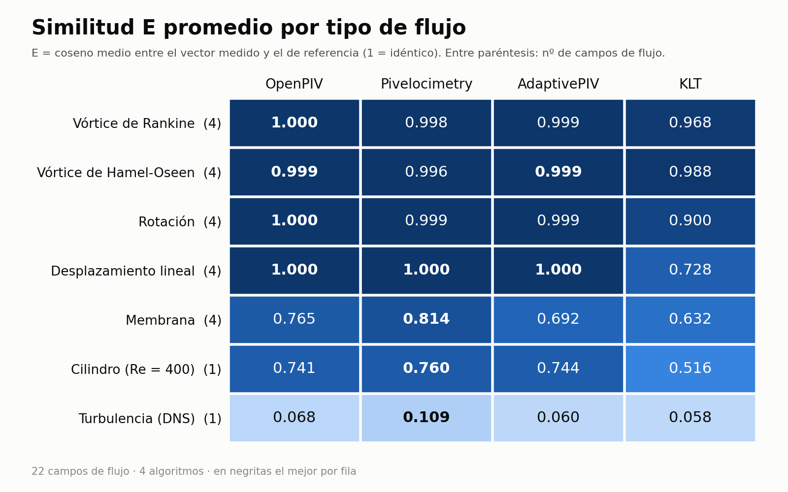
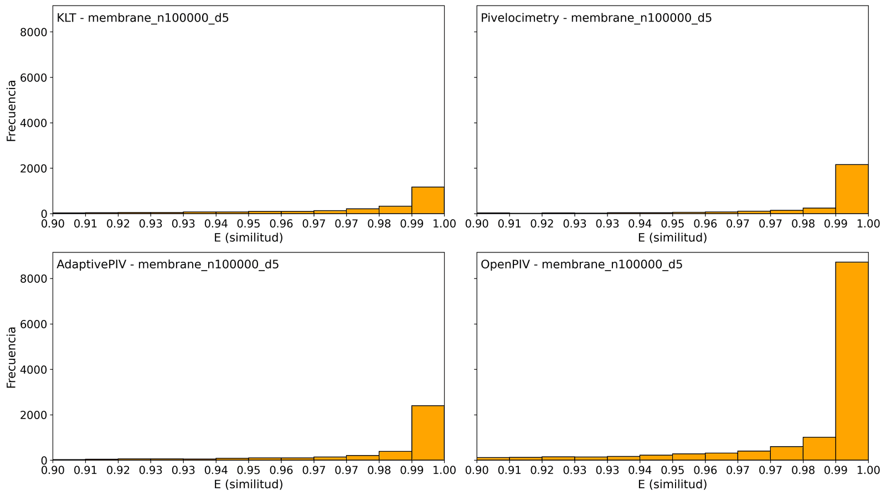
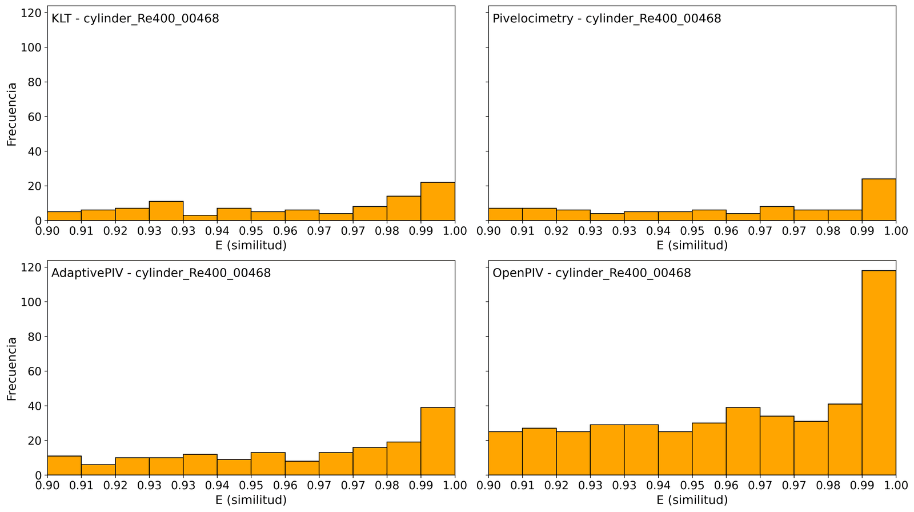

# Comparador de Algoritmos de Rastreo de Partículas (PIV)

Herramienta de escritorio que ejecuta **cuatro algoritmos de velocimetría por imágenes de partículas (PIV)** sobre los mismos pares de imágenes y mide, con una métrica de similitud coseno, **qué tan bien reproduce cada uno el flujo real**. Responde una pregunta práctica: *¿qué algoritmo conviene usar para cada tipo de flujo?*

> Proyecto terminal (tesis de licenciatura) de **Ingeniería en Computación** en la **Universidad Autónoma Metropolitana, Unidad Azcapotzalco** · agosto 2025 – abril 2026.



---

## Funcionalidades

- **Cuatro algoritmos en una sola interfaz**: OpenPIV (Python), AdaptivePIV (Python + Cython), Pivelocimetry (C++) y KLT, el rastreador de características Kanade-Lucas-Tomasi (C).
- **Comparación automática** con el botón *Compare algorithms*: procesa todos los pares de imágenes con los cuatro algoritmos y compara cada resultado contra el flujo de referencia (`.flo`).
- **Métrica de similitud E**: es el coseno del ángulo entre el vector medido y el vector real en cada punto. Vale 1 si las direcciones coinciden y 0 si son perpendiculares.
- **Procesamiento en paralelo**: reparte los pares de imágenes entre varios núcleos con un *pool* de procesos.
- **Gráficas generadas automáticamente**: un histograma 2×2 de E por cada flujo (uno por algoritmo) y una gráfica de barras con el porcentaje de vectores inválidos. Además exporta la tabla `all_algorithms_df.csv`.
- **Parámetros de cada algoritmo editables desde la GUI**, como el tamaño de ventana, el traslape, el número de picos y los más de 20 parámetros del KLT. Antes, esos parámetros estaban fijos en el código C/C++.

## Resultados principales

Se evaluaron **22 campos de flujo de 7 tipos**:

- 5 flujos sintéticos, cada uno con 4 variantes de densidad (20 000 o 100 000 partículas) y diámetro de partícula (3 o 5 px).
- 1 flujo alrededor de un cilindro (Re = 400).
- 1 flujo turbulento obtenido por simulación numérica directa (DNS).



En pocas palabras:

- **Flujos ordenados (vórtices, rotación, desplazamiento uniforme):** los tres métodos de correlación (OpenPIV, AdaptivePIV y Pivelocimetry) son prácticamente exactos, con E ≥ 0.996.
- **Flujos complejos (membrana, estela de un cilindro):** **Pivelocimetry** es el más preciso (E = 0.81 y 0.76). En la membrana le sigue OpenPIV (0.77); en el cilindro, OpenPIV y AdaptivePIV quedan muy cerca (≈ 0.74).
- **KLT** rastrea partículas individuales en vez de ventanas. Es el menos preciso en promedio (E = 0.79 frente a 0.89–0.91 de los demás), sobre todo con pocas partículas: en desplazamiento lineal con 20 000 partículas obtiene E = 0.46. Con más densidad de partículas mejora hasta E ≈ 0.999.
- **Turbulencia (DNS):** ningún algoritmo la reproduce bien (E < 0.11). Es el caso más difícil del conjunto.
- **Promedio de los 22 flujos:** Pivelocimetry 0.914 · OpenPIV 0.903 · AdaptivePIV 0.889 · KLT 0.793.

Los valores completos por flujo están en [`docs/resultados/all_algorithms_df.csv`](docs/resultados/all_algorithms_df.csv).

### Ejemplos de las gráficas que genera la interfaz

Distribución de E en el flujo de membrana (100 000 partículas, diámetro de 5 px):



Distribución de E en la estela de un cilindro (Re = 400):



## Tecnologías

| Área | Herramientas |
|---|---|
| Lenguajes | Python 3.12 / 3.7, C, C++, Cython, Bash |
| Interfaz | Tkinter + Matplotlib (`FigureCanvasTkAgg`) |
| Cálculo y datos | OpenPIV, NumPy, SciPy, pandas, scikit-image, Pillow |
| Paralelismo | `multiprocessing` (pool de procesos), `threading` |
| Integración | `subprocess`: los algoritmos en C/C++ y AdaptivePIV se ejecutan como programas externos |
| Empaquetado | PyInstaller (AdaptivePIV), Make (KLT), CMake (Pivelocimetry) |
| Plataforma | Linux (Ubuntu) |

## Estructura del repositorio

```
├── openpiv_tk_gui-master/      Interfaz gráfica (fork de OpenPIV-Tk-GUI) – aquí está la mayor parte del trabajo
│   └── openpivgui/
│       ├── OpenPivGui.py       Ventana principal, comparación de algoritmos y gráficas
│       ├── MultiProcessing.py  Ejecución en paralelo de cada algoritmo y cálculo de E
│       ├── OpenPivParams.py    Parámetros de los 4 algoritmos que se muestran en la GUI
│       ├── results_utils.py    Métrica de similitud E (nuevo)
│       └── flo_utils.py        Lectura de archivos .flo de referencia (nuevo)
├── AdaptivePIV_3.7/            AdaptivePIV (Python 3.7 + Cython), adaptado para recibir parámetros por consola
├── KLT/                        Rastreador KLT en C, adaptado para recibir parámetros y exportar .vec
├── docs/
│   ├── img/                    Capturas y gráficas del README
│   ├── notas/                  Bitácoras con los cambios hechos a cada componente
│   └── resultados/             Tabla de resultados (E por flujo y algoritmo)
├── 1_create_venvs.sh … 4_init_interface.sh   Scripts de instalación y arranque
└── requirements.txt            Dependencias de la interfaz
```

En [`docs/notas/`](docs/notas/) se documenta, archivo por archivo, qué se modificó del código original de OpenPIV-Tk-GUI, KLT y AdaptivePIV. En el código, las partes nuevas están marcadas con bloques `CONTRIBUCIÓN`.

## Instalación y ejecución

> El proyecto se desarrolló y probó en **Ubuntu**. KLT, Pivelocimetry y los scripts `.sh` dependen de Linux.

### 1. Requisitos del sistema

```bash
sudo apt install python3.12 python3.12-venv python3-tk build-essential cmake

# AdaptivePIV necesita Python 3.7
sudo add-apt-repository ppa:deadsnakes/ppa
sudo apt update
sudo apt install python3.7 python3.7-venv python3.7-dev
```

### 2. Clonar el repositorio

```bash
git clone https://github.com/YoshiBlaA/particle-tracking-comparator.git
cd particle-tracking-comparator
```

### 3. Compilar KLT

```bash
cd KLT
make lib && make example1
cd ..
```

### 4. Pivelocimetry (dependencia externa)

Pivelocimetry es un programa en C++ de Benjamin Pelc y no se incluye en este repositorio porque no tiene licencia de redistribución. Para usarlo:

1. Coloca su código en la carpeta `Pivelocimetry/`, en la raíz del repo.
2. Compílalo siguiendo su propio README. Requiere CMake, Gtkmm-3 y TCLAP.
3. Comprueba que el ejecutable quede en `Pivelocimetry/build/piv`.

Sin él, los otros tres algoritmos funcionan igual.

### 5. Entornos virtuales, AdaptivePIV e interfaz

```bash
bash 1_create_venvs.sh               # crea v/ (Python 3.12) y AdaptivePIV_3.7/venv (Python 3.7)
bash 2_install_venvs_dependencies.sh # instala requirements.txt en cada entorno
bash 3_configure_adaptivepiv.sh      # compila las extensiones Cython y empaqueta AdaptivePIV con PyInstaller
bash 4_init_interface.sh             # abre la interfaz
```

### 6. Datos de entrada

Las imágenes de partículas y los flujos de referencia **no se incluyen** por su tamaño. La interfaz espera una carpeta con esta estructura:

```
mis_flujos/
├── rankine_vortex_n20000_d3_sh10_img1.png    ← par de imágenes (png, tif, bmp…)
├── rankine_vortex_n20000_d3_sh10_img2.png
├── ...
└── flo/
    ├── rankine_vortex_n20000_d3_sh10_flow.flo   ← campo de velocidades real (formato Middlebury .flo)
    └── ...
```

En la interfaz, abre los pares de imágenes con **File → Import files** o **File → Import directory**. Ajusta los parámetros de cada algoritmo en **Analysis → AdaptivePIV / Pivelocimetry / KLT**. Luego entra a **Analysis → Start algorithms comparison** y presiona **Compare algorithms**. Los histogramas se guardan en `openpiv_tk_gui-master/graficas/` y la tabla de resultados en `openpiv_tk_gui-master/all_algorithms_df.csv`.

## Créditos y licencia

Este proyecto integra y modifica software de terceros:

- **[OpenPIV-Tk-GUI](https://github.com/OpenPIV/openpiv_tk_gui)**, de P. Vennemann y colaboradores, con licencia GPLv3. Es la base de la interfaz.
- **[OpenPIV](https://github.com/OpenPIV/openpiv-python)**, la biblioteca de PIV en Python.
- **[AdaptivePIV](https://github.com/MattEdwards94/pivDevPython)**, de Matt Edwards, con licencia MIT.
- **[KLT](https://cecas.clemson.edu/~stb/klt/)**, de Stan Birchfield y Thorsten Thormählen, de dominio público.
- **Pivelocimetry**, de Benjamin Pelc. No se incluye en este repositorio.

Como la interfaz deriva de OpenPIV-Tk-GUI, el conjunto se distribuye bajo la **GNU General Public License v3**. Consulta [`LICENSE`](./LICENSE).

## Autor

**Jairo Cortés Morales** · [jairocortes.cloud](https://jairocortes.cloud) · [GitHub @YoshiBlaA](https://github.com/YoshiBlaA)
